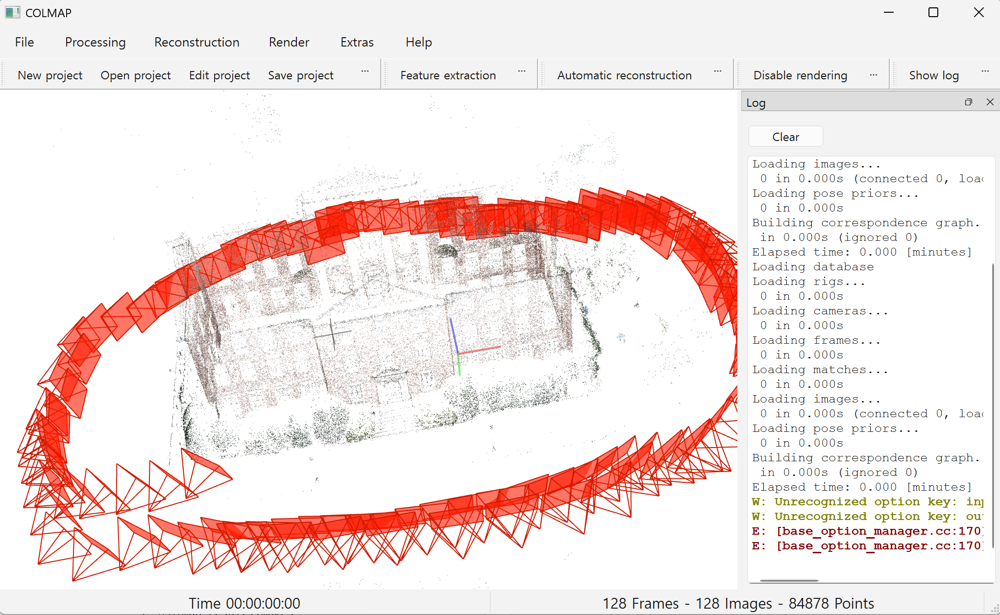

# 서울역 실내 AR 길찾기 서비스

## 개요

서울역 특정 환승 동선을 대상으로, 서버 기반 Visual Positioning System(VPS)을 통해 주기적으로 위치를 갱신하는 방식의 실내 AR 길찾기 서비스를 제안합니다. 오프라인 3차원 지도 구축과 온라인 6DoF 위치 추정 모두 서버 연산에 의존하는 구조이며, 각 단계에 검증된 최신 컴퓨터 비전 기술을 적용합니다.

## 1. 오프라인 지도 구축

역사 내부 촬영 이미지에서 특징점을 추출·매칭하여 3차원 특징점 지도를 구축합니다.

| 단계 | 기술 |
|---|---|
| 특징 추출 | SuperPoint |
| 특징 매칭 | LightGlue |
| 3D 재구성 | COLMAP (global mapper) |
| 동적 객체 마스킹 | SAM |

## 2. 서버 기반 위치 추정 및 이동 추적

디바이스는 카메라 프레임을 서버로 전송하고, 서버가 매 질의마다 6DoF 위치를 계산해 응답하는 방식으로 이동을 추적합니다.

| 단계 | 기술 |
|---|---|
| 이미지 검색 | MegaLoc |
| 특징 매칭 | SuperPoint + LightGlue |
| 자세 추정 | PnP · RANSAC |
| 위치 검증 | YOLO11 (랜드마크 교차 검증) |
| 동적 객체 마스킹 | YOLO26 (질의 이미지 전처리) |

목표 성능: 질의 응답 2초 이내, 위치 오차 0.5m 이내, 질의 주기는 네트워크 부하·정확도 트레이드오프를 실험으로 결정

## 3. 경로 안내

| 단계 | 기술 |
|---|---|
| 경로 탐색 | A* |
| AR 렌더링 | Three.js / WebXR |
| 구동 플랫폼 | 삼성 Android PWA |

## 4. 비교 실험

구조 기반 방식(위 파이프라인)과 Scene Coordinate Regression 방식(ACE, R-SCoRe)의 정확도·지도 크기·속도를 비교 검증합니다.

## 5. 데이터

- 서울역 직접 촬영 이미지 (시간대·혼잡도·조명 조건별)
- AI-Hub 실내 공간 데이터셋 (보조)

## 6. COLMAP 테스트
GitHub - colmap/colmap: COLMAP - Structure-from-Motion and Multi-View Stereo 
예시 데이터셋 south-building 구축 결과


---

**전체 파이프라인**

```
촬영 이미지
   → SuperPoint + LightGlue → COLMAP global mapper → SAM              [지도 구축]

디바이스 프레임 → 서버 전송
   → MegaLoc → SuperPoint + LightGlue → PnP·RANSAC → YOLO11/YOLO26     [서버 위치 추정]
   → 위치 응답 → A* → Three.js/WebXR                                  [경로 안내]
```